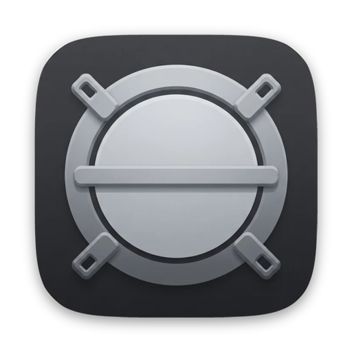
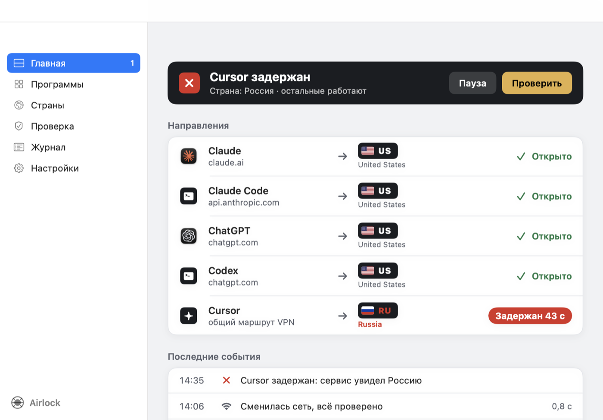
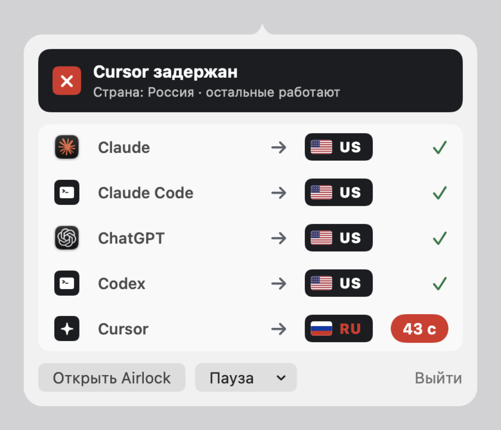
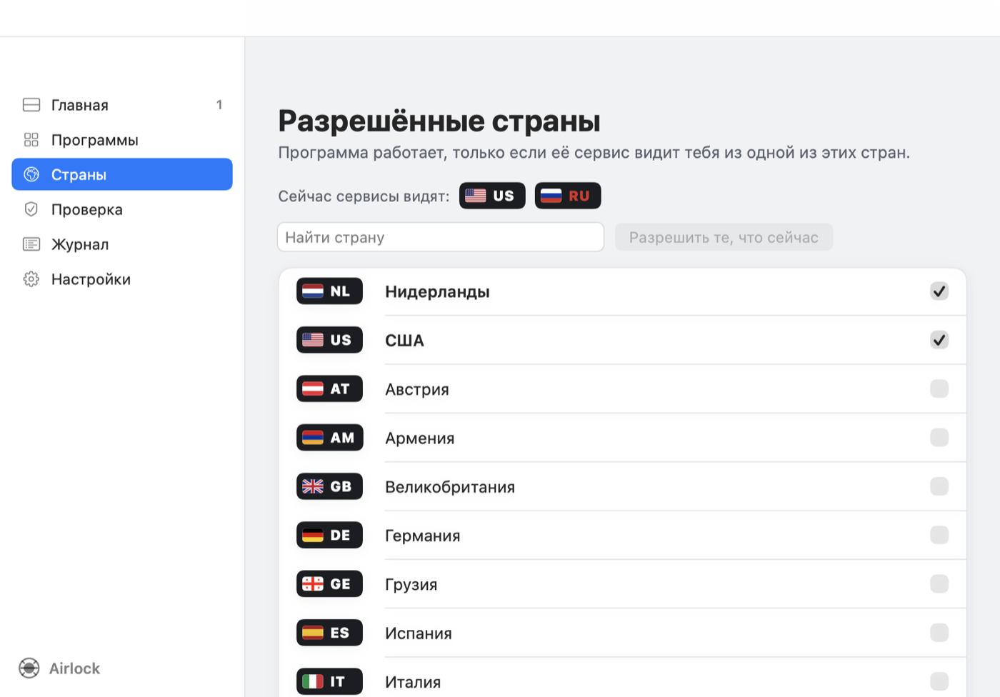
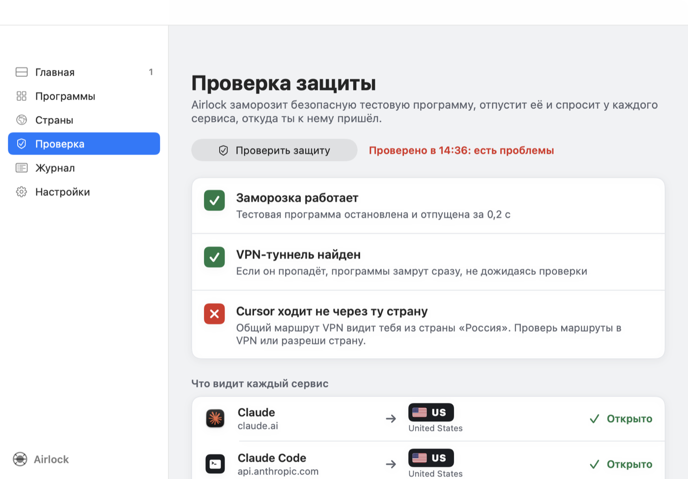
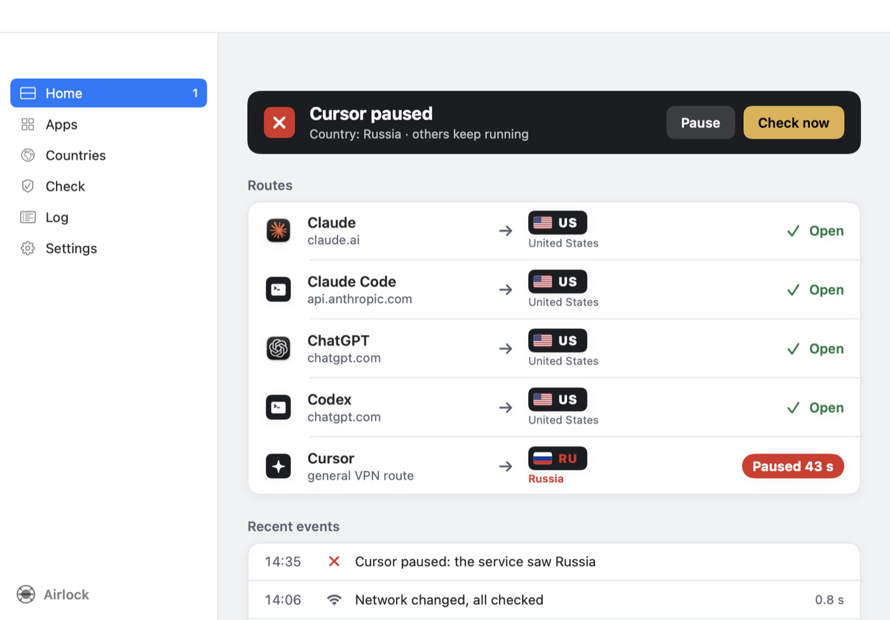

<p align="center"></p>

<h1 align="center">Airlock</h1>

<p align="center">Ставит Claude, ChatGPT, Codex и Cursor на паузу, если отвалился VPN или сервис видит тебя не из той страны.<br>Страна вернулась — программы продолжают с того же места.</p>

<p align="center"><a href="#english">English</a> · <a href="#установка">Установка</a> · <a href="#как-это-работает">Как работает</a> · <a href="#вопросы">Вопросы</a></p>

<p align="center"></p>

## Зачем

VPN рвётся постоянно: после сна, при смене Wi-Fi, на переподключении. Если в этот момент Claude Code или ChatGPT успеет сходить в сервис с настоящего адреса, аккаунт может уйти в бан. Airlock следит за этим за тебя и замораживает нужные программы раньше, чем они что-то отправят.

- **Страну спрашивает у самого сервиса.** Airlock обращается к `claude.ai/cdn-cgi/trace`, `chatgpt.com/cdn-cgi/trace` и так далее, то есть видит ровно то, что видит сервис. Если VPN ведёт часть сайтов напрямую, обычная проверка IP этого не заметит, а Airlock заметит.
- **Пауза вместо закрытия.** Программа замирает вместе со всеми своими процессами (терминал, MCP-серверы, git) и продолжает работу с того же места. Несохранённое не пропадает.
- **Реагирует мгновенно.** Пропал VPN-туннель или сменилась сеть — заморозка срабатывает в момент сигнала от macOS, ещё до новой проверки.
- **Без аккаунтов и сбора данных.** Никакой регистрации, телеметрии и серверов автора. Airlock только спрашивает у сервисов страну раз в 3 секунды.
- **Можно убедиться, что работает.** Кнопка «Проверить защиту» замораживает тестовую программу, отпускает её и показывает, что видит каждый сервис.

<p align="center"></p>

## Установка

Нужен macOS 14 или новее.

**Через Homebrew** (проще всего):

```sh
brew install onkhas1/tap/airlock
```

**Одной командой без Homebrew:**

```sh
curl -fsSL https://raw.githubusercontent.com/onkhas1/airlock/main/install.sh | sh
```

**Вручную:** скачай `Airlock-<версия>.zip` из [Releases](https://github.com/onkhas1/airlock/releases), распакуй и перетащи Airlock в «Программы».

### Первый запуск при ручной установке

Airlock бесплатный и не подписан платным сертификатом Apple, поэтому при первом открытии скачанного вручную архива macOS скажет, что не может проверить разработчика. Один раз сделай так:

1. Открой «Системные настройки» → «Конфиденциальность и безопасность».
2. Внизу, рядом с сообщением про Airlock, нажми «Всё равно открыть».

Или в Терминале: `xattr -dr com.apple.quarantine /Applications/Airlock.app`. Установка через Homebrew и командой выше делает это сама.

## Как это работает

1. При первом запуске Airlock спрашивает у сервисов, где ты сейчас, и разрешает эти страны. Список можно поменять в разделе «Страны».
2. Каждые 3 секунды он снова спрашивает каждый сервис. Не та страна или сервис молчит дважды подряд — программа замораживается.
3. Сменилась сеть или пропал туннель — замораживается всё сразу, до первой свежей проверки.
4. Нужная страна вернулась — программы продолжают работу.

Под защитой по умолчанию: **Claude, Claude Code, ChatGPT, Codex, Cursor**. Любую другую программу можно добавить в разделе «Программы» и указать для неё сайт проверки.

<p align="center"> </p>

## Вопросы

**Это гарантия, что IP никогда не утечёт?**
Airlock замораживает программы за доли миллисекунды после сигнала macOS, но пакет, который программа успела отправить до этого, уже не вернуть. Для полной защиты включи ещё kill switch в своём VPN-клиенте: он режет весь трафик на уровне системы. Вместе они закрывают оба сценария.

**Что, если Airlock упадёт с замороженными программами?**
Он запускается через launchd: macOS сама поднимет его через несколько секунд, и он первым делом отпустит всё, что заморозил. На крайний случай: `/Applications/Airlock.app/Contents/MacOS/Airlock --unfreeze`.

**Почему моя программа проверяется «через www.cloudflare.com»?**
У своих программ нет служебной страницы с твоей страной, поэтому по умолчанию Airlock смотрит общий маршрут VPN. Если программа работает с конкретным сайтом за Cloudflare (например, figma.com), укажи его: нажми на строку «Проверка через…» в разделе «Программы».

**Нужны права администратора?**
Нет. Airlock останавливает только твои собственные программы.

**Как удалить?**
`brew uninstall --zap airlock` или выключи «Запускать вместе с системой», закрой Airlock и удали его из «Программ». Настройки лежат в `~/Library/Application Support/Airlock`.

## Поддержать

Airlock бесплатный и без рекламы. Если он тебе пригодился, можно [поддержать проект донатом](https://pay.cloudtips.ru/p/1a375628).

Связь: [Telegram](https://t.me/onkhas) · [почта](mailto:byonkhas@gmail.com) · [issues](https://github.com/onkhas1/airlock/issues)

---

## English

Airlock pauses Claude, ChatGPT, Codex and Cursor when your VPN drops or a service sees you in the wrong country. Once the right country is back, they continue where they left off.

<p align="center"></p>

- **Asks the service itself.** Airlock checks `claude.ai/cdn-cgi/trace`, `chatgpt.com/cdn-cgi/trace` and so on, so it sees exactly what the service sees, even when your VPN routes some sites directly.
- **Pauses instead of quitting.** The whole process tree is suspended (terminal, MCP servers, git) and resumes right where it stopped.
- **Reacts instantly.** When the tunnel disappears or the network changes, apps are paused the moment macOS reports it.
- **No accounts, no tracking.** No sign-up, telemetry or author servers. Just a country check every 3 seconds.
- **Self-check.** "Run check" pauses a test process, resumes it and shows what each service sees.

**Install:** `brew install onkhas1/tap/airlock`, or `curl -fsSL https://raw.githubusercontent.com/onkhas1/airlock/main/install.sh | sh`, or download the zip from Releases. Requires macOS 14+. For a manual download, open it once via System Settings → Privacy & Security → "Open Anyway", since Airlock is free and not signed with a paid Apple certificate.

**Is it a guarantee?** Airlock pauses apps within a fraction of a millisecond after macOS reports a change, but anything already sent can't be recalled. Turn on your VPN client's kill switch as well for full coverage.

Airlock is free, with no ads. If it helped you, you can [support the project with a donation](https://pay.cloudtips.ru/p/1a375628).

© 2026 Alexander Sakhno. Free to use, see [LICENSE](LICENSE).
